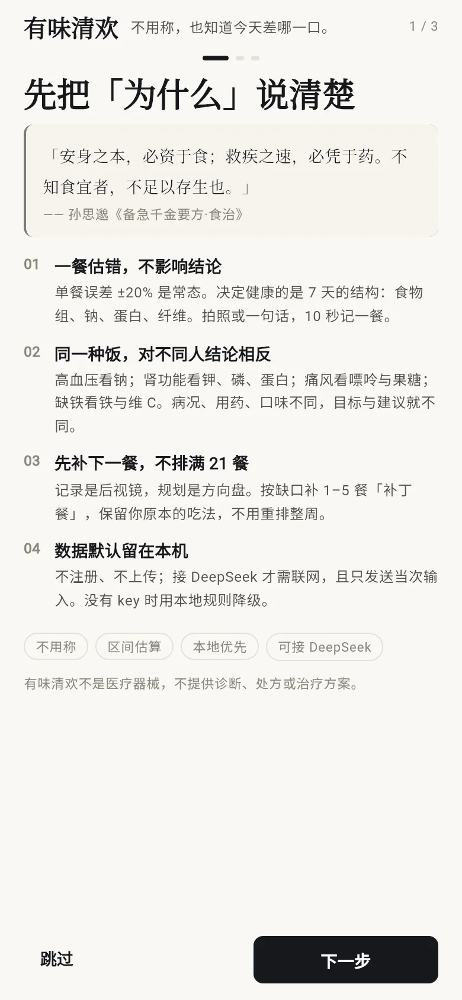
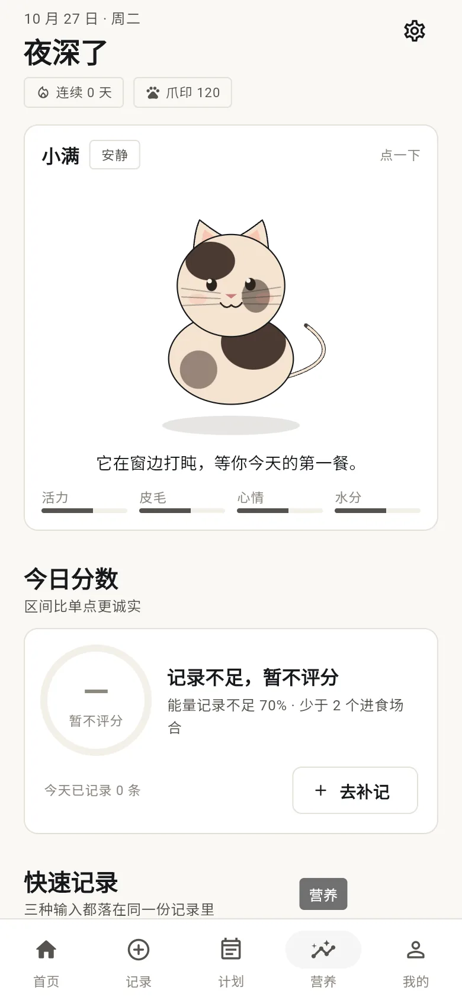

**中文** ｜ [English](README.en.md) ｜ [展示页](https://eavebounty.github.io/plainjoy/)

# 有味清欢 · Plainjoy

有味清欢 Plainjoy 是本地优先的 Android 营养记录与饮食记录 app：不称重估算份量，按病况调整目标，用补丁餐补下一餐。

> 慢慢吃，吃到刚好。

一个**本地优先**的 Android 营养记录与下一餐规划 app。不做 21 餐完美计划，也不逼你称重：
拍照或一句话记一餐，按你的病况与缺口补 1–5 餐「补丁餐」，再看 16 项营养充足度与一只猫的状态。

- 包名：`com.eavebounty.plainjoy`
- 当前版本：`0.2.0+2`
- 平台：**Android 优先**；Web / Linux / Windows 为附带产物
- 语言：中文（简体）
- 许可：PolyForm Noncommercial License 1.0.0（**非 OSI 开源**，商业使用需授权）





---

## 下载

- [v0.2.0 Android APK](https://github.com/EaveBounty/plainjoy/releases/tag/v0.2.0)：`arm64-v8a` 推荐；老 32 位设备用 `armeabi-v7a`，模拟器用 `x86_64`
- 最低 Android 7.0；公开 APK 只含 102 条种子食物，不含全量成分表
- 校验：Release 内附 `SHA256SUMS.txt`

---

## 1. 它解决什么问题

主流饮食 app 的隐含前提是「你能称重、愿意每天记 20 项、并且有明确减脂目标」。
有味清欢的前提相反：

| 现实 | 设计回应 |
|---|---|
| 不知道一碗饭多少克 | 容器标定 + 参照物 + 目测区间，L1 10 秒 ±35–45% |
| 一餐估错就放弃 | 单餐误差不影响结论，7 天结构才算数；区间优先，不假装精确 |
| 有高血压/肾病/痛风/孕期 | 病况直接改目标、改评分权重、改建议，不是贴一段通用文案 |
| 外卖/食堂无法拆解 | 先记整份，再用「调味品单独成条」捕捉隐形钠 |
| 计划太复杂坚持不了 | 只补下一餐 1–5 餐，保留你原本的吃法 |
| 记录很枯燥 | 四轴宠物（活力/皮毛/心情/水分）+ 周报，不做死亡与惩罚 |

### 核心闭环

```
记录（照片/文字/搜索）
  → 16 项评分（食物组 40 / 营养素 32 / 限制项 28，蒙特卡洛区间）
  → 一条最值得做的建议（按病况加权）
  → 下一餐「补丁餐」（确定性求解，LLM 只叙述）
  → 投喂宠物 / 周报
```

---

## 2. 已实现功能

### 2.1 记录与份量

- 文字一句话解析（本地规则，无 key 也能用）
- 照片识别（DeepSeek Vision，返回严格 JSON；本地库优先，查不到才用 AI 估算并标注）
- 食物搜索：种子库 102 条 + 调味品 22 条 + 本地全量成分表（存在时 1677 条）
- 份量三档：10 秒 / 60 秒 / 3 分钟；容器标定、参照物、剩饭扣除
- 每条记录保存营养快照，后续换库不会篡改历史

### 2.2 个性化营养

`lib/core/health/condition_policy.dart` 把病况映射为三类东西：

1. **目标覆盖**（钠、蛋白、钾、磷、碘、叶酸、铁、钙、水）
2. **评分权重乘数**（如高血压：钠 ×1.8、蔬菜 ×1.25）
3. **禁忌与就医提示**

支持：高血压、糖尿病、糖尿病前期、痛风/高尿酸、慢性肾病（含透析开关）、贫血、乳糖不耐、素食、孕期、哺乳期。
多病况叠加时：**上限取更严、下限取更高；冲突时保留上限并写明**（例如 CKD + 高血压，钾的 3600 mg 下限会让位于 2500 mg 上限）。

评分现在会检查**数据覆盖率**：某营养素覆盖不足 60% 能量时，该项显示「数据不足」并退出分母，
不再把「没记录」当成 0 分或满分。这是 v0.2 最重要的正确性修复。

### 2.3 食谱细节与钠账本

- 30 个家常食谱，每条都补了**调味估算**（盐/生抽/老抽/蚝油/味精/糖/醋/芝麻酱）。
- 展开食谱可看「钠账本」：总钠、折算盐、Top 4 来源、区间 ±15%。
- 调味品按品种拆分：加碘盐 / 无碘盐 / 低钠盐（含钾警告）/ 生抽 / 老抽 / 蚝油 / 味精 / 鸡精 / 豆瓣酱 / 甜面酱 / 番茄酱 / 芝麻酱 / 料酒 / 陈醋 / 腐乳 / 榨菜 / 咸鸭蛋 / 火锅底料 / 沙拉酱。
- 关键换算：1 g 盐 ≈ 393.7 mg 钠；味精 1 g ≈ 123 mg 钠；生抽按 6.6 g 钠/100 g、老抽 7.0 g/100 g。

### 2.4 营养面板与评分

- 日/周/月总分，p10–p90 区间；320 次蒙特卡洛
- 16 项分解：食物组 6 项、营养素 7 项、限制项 3 项（CKD 另加钾/磷）
- 守门上限：食物结构偏弱、钠过高、限制项失控、超加工供能过高
- 周报：趋势、缺口、最值得改的一件事

### 2.5 宠物

- 四轴：活力 / 皮毛 / 心情 / 水分；7 日滚动；体型恒定；永不死亡/生病
- 双皮肤共享同一骨架：报告版（纸感/衬线）+ 绘本版（奶油/雾紫/硬阴影）
- 单币「爪印」，宠物与剧本可购买，不抽卡

### 2.6 数据与隐私

- Sembast 本地库；不注册、不上传
- 备份导出为 JSON（**不含 API key**）
- Android `allowBackup=false`，云备份与设备迁移都排除数据库
- AI 仅在用户填 key 并显式开启后调用；请求只含当次输入与食物名，不含健康档案

---

## 3. 快速开始

### 环境

- Flutter 3.44.3 / Dart 3.12.2（不要盲目升级：`freezed 4` 等依赖要求 Dart 3.13）
- Android SDK；JDK 17
- Python 3.11+（仅生成资产/导入数据时需要）

### 运行

```bash
flutter pub get
flutter run -d <device>
```

### 构建 Android

```bash
flutter build apk --release --split-per-abi
# 产物：build/app/outputs/flutter-apk/app-*-release.apk
```

发布签名读取 `android/key.properties`（已 gitignore）：

```properties
storePassword=...
keyPassword=...
keyAlias=plainjoy
storeFile=keystore/plainjoy-release.jks
```

**签名文件与密码必须自行离线备份**；丢失后无法覆盖升级。

### 构建 Web

```bash
# 有网：CanvasKit 会从 CDN 拉 CJK 回退字体
flutter build web --release

# 完全离线：需要自带 CJK 字体，否则汉字会变方框（已知限制）
flutter build web --release --no-web-resources-cdn
```

### 测试与静态检查

```bash
flutter analyze     # 0 error
flutter test        # 16/16
```

---

## 4. 数据与版权（重要）

### 4.1 公开仓库包含什么

- `assets/seed/foods.json`：102 条**独立近似估算**（不是任何受版权数据库的派生副本）
- `assets/seed/condiments.json`：22 条标签区间估算
- `assets/seed/recipes.json`：30 个食谱
- `assets/data/cn_food_manifest.json`：字段覆盖率统计（不含具体食物数值）

### 4.2 公开仓库不包含什么

`assets/private/cn_food_full.json` 是从《中国食物成分表（标准版 第6版）》「能量和食物一般营养成分」表
转换的本地检索库，**已被 `.gitignore` 排除，不随仓库分发**。

- 本地存在该文件：app 自动合并 1677 条；
- 克隆后不存在：自动退回 102 条，不报错；
- **禁止**把该文件或含该文件的 APK/AAB/Web 产物上传到 GitHub Release、Actions artifact、Pages 或应用商店。

这不是「开源数据」，而是需要在取得授权后自行准备的数据包。详见 [`docs/DATA.md`](docs/DATA.md)。

### 4.3 转换与审计

```bash
python tool/import_cfct.py --input-dir /path/to/merged_json_dir
```

导入器做了：

- 单位归一化、`Tr`/`—` 处理、缺失保持缺失（不写 0）
- 能量列错位修正（140 条 kJ/kcal 互换，用 4/9/4 反推）
- 原表没有的添加糖/饱和脂肪/UPF 用保守估算，逐条标 `estimated`
- 原表没有的碘、VD、B12、叶酸、嘌呤保持未知，不伪造

---

## 5. 目录结构

```
lib/
  app.dart                      启动闸门 + 主题
  core/
    ai/ai_service.dart          DeepSeek JSON 解析 + 本地匹配 + 值域校验
    db/app_repository.dart      Sembast、种子合并、导入导出
    health/condition_policy.dart 病况 → 目标/权重/禁忌
    health/advice_engine.dart   今日摄入 → 可执行建议
    health/health_rules.dart    静态规则卡
    scoring/                    16 项评分、覆盖率、蒙特卡洛
    plan/plan_engine.dart       缺口驱动补丁餐
    portion/                    容器/参照物/份量区间
    state/                      Riverpod 状态
  features/
    splash/                     30° 三角开屏
    onboarding/                 首启三屏（为什么/画风/精度）
    home/ record/ nutrition/ plan/ pet/ profile/ settings/
assets/
  seed/                         可公开的种子数据
  private/                      本地全量数据（gitignore）
  brand/                        开屏底图（WebP）
  icon/                         像素猫图标
docs/
  PRODUCT_DESIGN.md             产品设计基线
  PLAN.md                       里程碑与风险
  DATA.md                       数据来源、覆盖率、法务边界
  PERSONALIZATION.md            病况映射与证据等级
  REVIEW.md                     多视角审查与修复记录
tool/
  import_cfct.py                成分表转换
  generate_brand_assets.py      图标/开屏生成
  generate_condiments.py        调味品表
  generate_seed.py              种子库
```

---

## 6. 对比：有味清欢 vs 热量打卡类 app

| 维度 | 有味清欢 Plainjoy | 热量打卡类 app（常见做法） |
|---|---|---|
| 是否称重 | 不要求；容器 + 参照物 + 剩饭，份量以区间保存 | 常以克数为唯一入口，需要食物秤或包装标签 |
| 是否按病况改目标 | 高血压/糖尿病/痛风/CKD/孕期等 10 类病况直接改目标与评分权重 | 多为统一热量配额，病况只做提示 |
| 数据位置 | 本地 Sembast，无账号；AI 可选且只发当次输入 | 常见为账号 + 云同步 |
| 计划粒度 | 只补下一餐 1–5 餐「补丁餐」 | 常见为整周餐单或每日配额 |

右列是对同类产品常见设计假设的归纳，不针对具体产品。

## 7. 常见问题 FAQ

### 不用称重怎么记录饮食？

选一个常用碗和勺子做一次标定，之后记「少/中/多」和剩了多少；份量以区间保存，10 秒一餐。单餐误差不会直接推翻结论，评分看 7 天结构。

### 不称重怎么估算食物重量？

三个锚点：容器（你的碗、勺、外卖盒）、参照物（手掌、鸡蛋、银行卡、拳头）、包装净含量。给区间而不是单点，例如「米饭 120–160 g」。

### 高血压饮食记录 app 怎么选？

看钠上限是否写进目标（≤2000 mg，理想 1500）、生抽/老抽/蚝油/味精能否单独记、评分权重是否随病况调整。有味清欢三项都做，并把钠折算成盐克数。

### 肾病饮食记录 app 要注意什么？

蛋白按体重与透析状态计算（非透析常见 0.6–0.8 g/kg，透析 1.0–1.2 g/kg），钾/磷上限按化验单，低钠盐含钾需慎用。有味清欢提供透析开关与 K/P 上限，但只做记录辅助。

### 本地优先饮食记录 app 有哪些？

有味清欢是其中一个：数据存在本地 Sembast，不注册、不登录；Android 自动备份关闭；AI 可选且只发当次输入。选其他工具时至少核对隐私政策、备份行为和 AI 请求范围。

### 拍照识别食物营养成分准吗？

照片只负责菜名与份量区间，营养优先查本地成分表；本地没有才接受 AI 的每 100 g 估算并标记为 `ai_estimate`。没有 key 时自动退回本地规则。

## 8. 已知限制

- 全量数据覆盖：磷/钾/碘/VD/B12/叶酸/嘌呤仍不完整；评分会标「数据不足」，但不代表真实摄入为 0。
- 添加糖/饱和脂肪为估算值，不是实验室实测。
- 照片识别依赖 DeepSeek Vision；无 key 时只能文字/搜索。
- API key 目前明文存于本地设置（备份已排除）。迁移到 Android Keystore 列入下一版。
- 网页版离线构建需要自带 CJK 字体；Android 使用系统字体，无此问题。
- 未做真实称重校准；份量区间来自文献与常见容器，需 50–100 次实测收敛。

---

## 9. 许可

本项目采用 **PolyForm Noncommercial License 1.0.0**。
个人学习、研究、非营利使用免费；**任何商业用途需另行书面授权**，见 [`COMMERCIAL.md`](COMMERCIAL.md)。

PolyForm NC 不是 OSI 认证的开源许可证，请勿称本项目为「开源软件」。

Required Notice: Copyright 2026 长沙市果垂素宇工程设计有限公司 (https://github.com/EaveBounty/plainjoy)

第三方资产：

- 图标、开屏底图：本仓库脚本生成，随项目许可
- 字体：调用系统 Noto，不随包分发
- Dart/Flutter 依赖：见 `pubspec.lock`

本项目不是医疗器械，不提供诊断、处方或治疗方案。

---

## 10. 修改日志

- 2026-10-27：品牌名改为「有味清欢」（Plainjoy 不变）；开屏、引导、设置、平台标签与文档全量同步。
- 2026-10-27：更名为「清欢 / Plainjoy」；新增 30° 三角开屏与高密度首启引导；像素猫图标；全量成分表本地导入 + 覆盖率感知评分；病况目标/权重/建议引擎；食谱调味与钠账本；DeepSeek JSON 营养回退；Android 签名/备份/明文流量加固；多视角审查修复。
- 2026-10-26：v0.1 完成记录、评分、补丁餐、宠物、双主题、备份。
